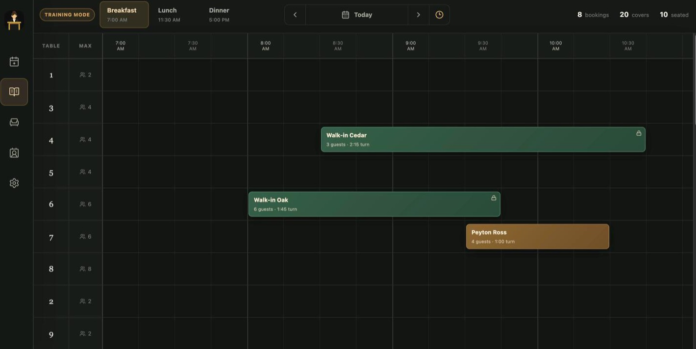
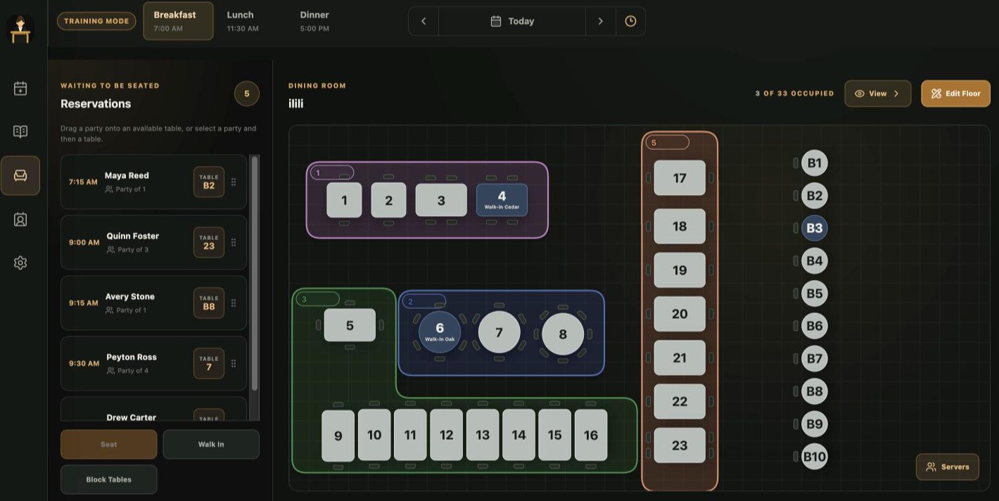
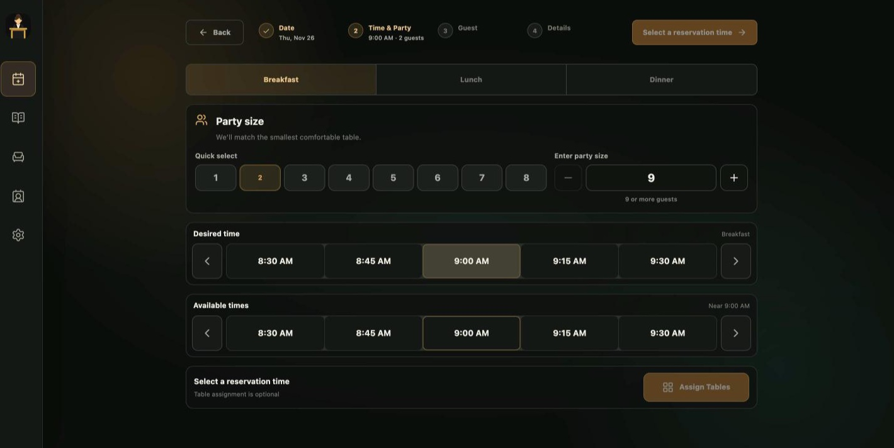

# Table Host

Table Host is a restaurant reservation and floor-management app for hosts running a busy dining
room. It covers the whole service: booking a party, planning the night on a timeline, and seating
guests on a live floor plan.

**Live demo:** [bengarlock.com/tablehost/floor](https://www.bengarlock.com/tablehost/floor) (runs in Training
Mode with sample guests)

This repository contains the Next.js frontend. The Django REST Framework API lives in a separate
backend (`portfolio_database/tablehost`) and is mounted at `/api/v1/tablehost/`.

## Screenshots

### Reservation grid

Each shift's bookings on a table-by-time timeline, with live counts of bookings, covers and seated
guests. Reservations and walk-ins can be moved between tables, and tables can be blocked.



### Floor plan

A live floor plan grouped into sections. Hosts drag a waiting party onto an open table to seat it,
and turn timers on each table show how far along each party is.



### Booking

A four-step booking flow: date, time and party size, guest, and details. Available times are
checked against table capacity, and assigning a table is optional.



## Features

- Breakfast, lunch and dinner shifts with day-by-day navigation
- Reservation grid with drag-to-reassign and table blocking
- Floor plan editor with sections, rotated tables and server assignments
- Booking wizard with party-size matching and availability by time
- Guest profiles with phone validation and reservation tags
- Change history for every reservation edit, with autosave
- Training Mode for demos and staff practice

## Tech stack

| Layer | Tools |
|---|---|
| Frontend | Next.js 16, React 19, TypeScript, Tailwind CSS 4 |
| Backend | Django REST Framework, PostgreSQL, Celery, Redis |
| Testing | Playwright end-to-end tests, ESLint |
| Hosting | Self-hosted on Linux with PM2 and NGINX; staging and production environments |

## Local development

The frontend defaults to `http://127.0.0.1:8000` for the Django backend in development and
`https://bengarlock.com` in production. Runtime overrides belong in the appropriate 1Password
Environment under `NEXT_PUBLIC_BACKEND_URL`.

```bash
npm install
npm run backend:check:dev
npm run dev
```

The local app is available at `http://127.0.0.1:3000/reservations`. Production builds use the
`/tablehost` base path.

Run the checks used before each deploy:

```bash
npm run deploy:check
```
